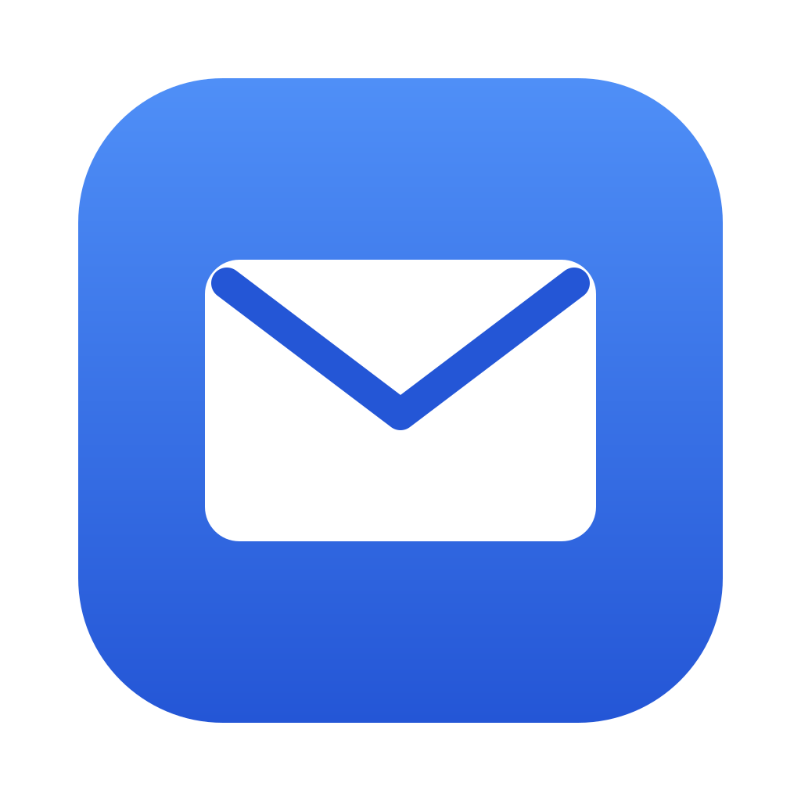
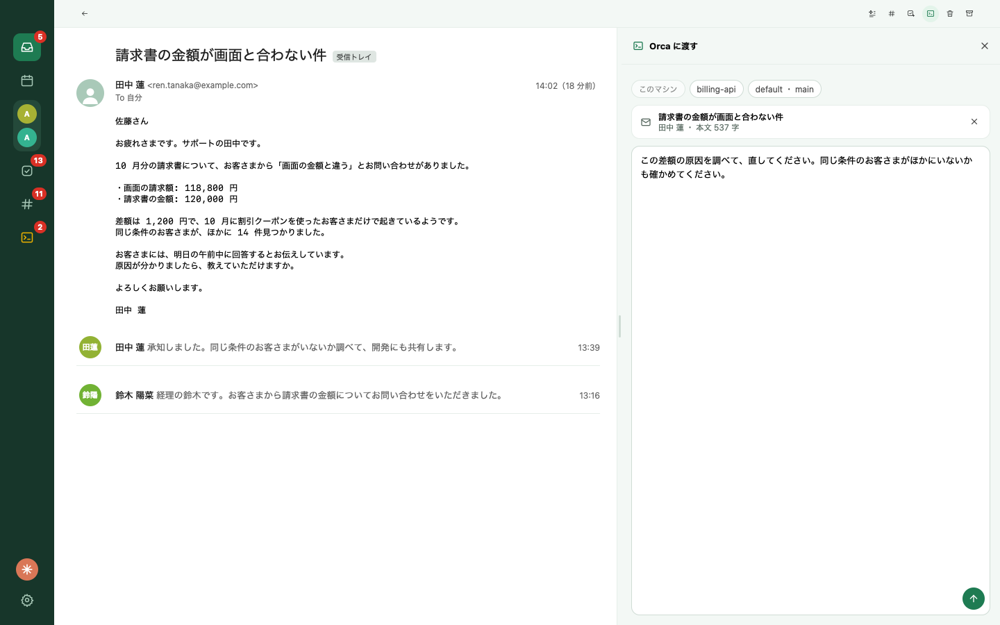
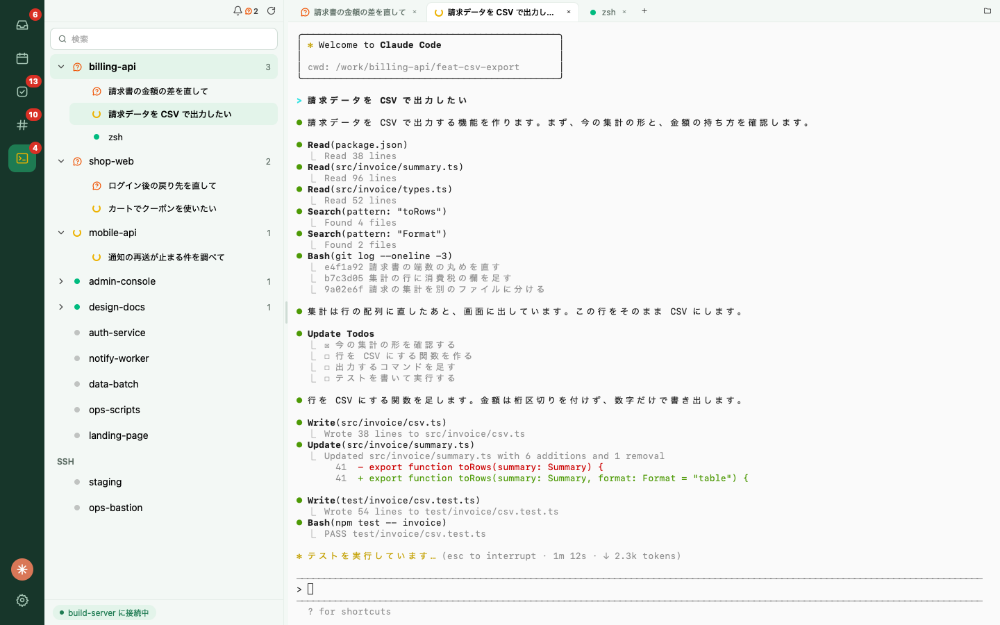
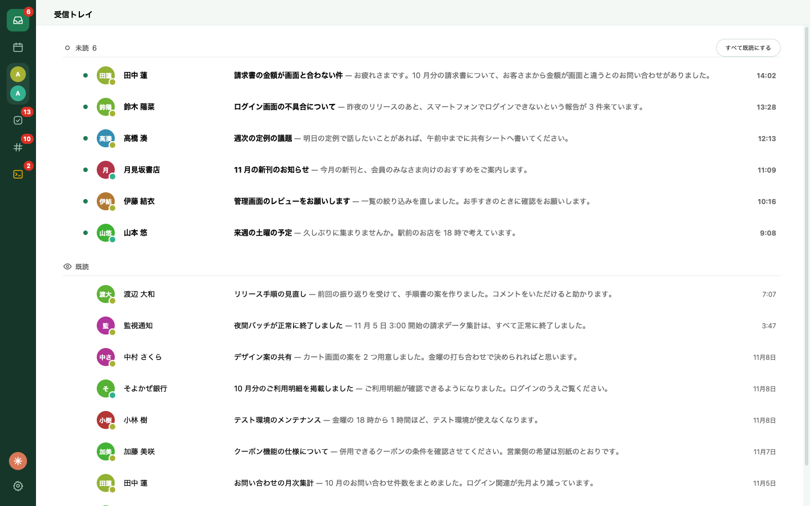
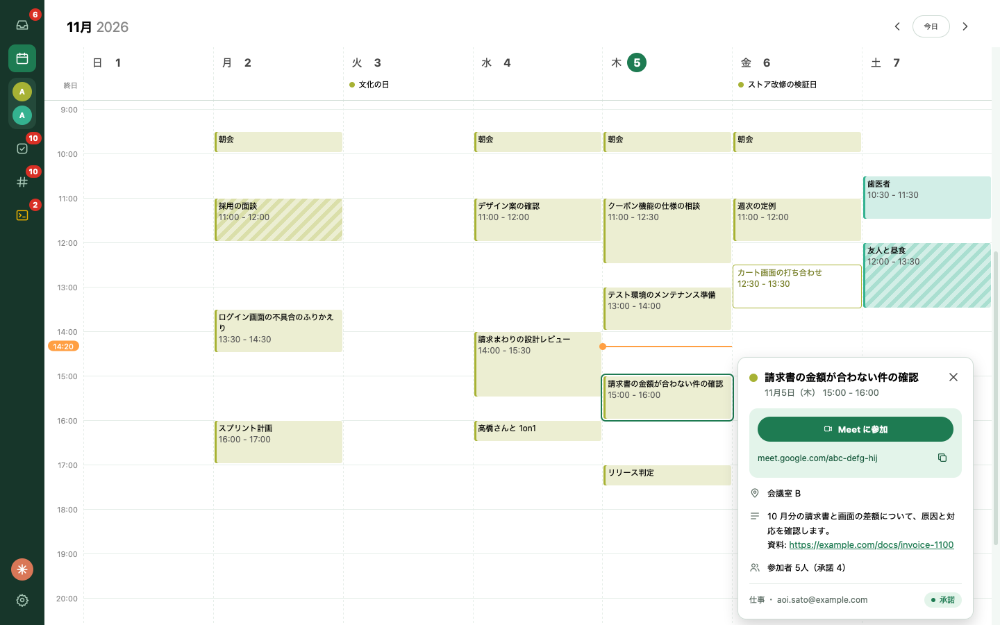
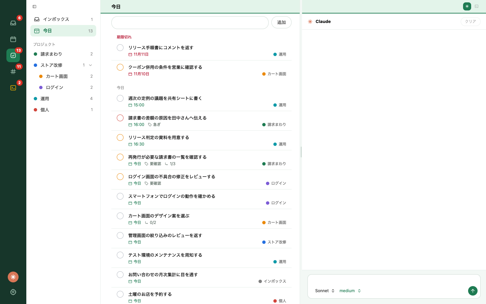
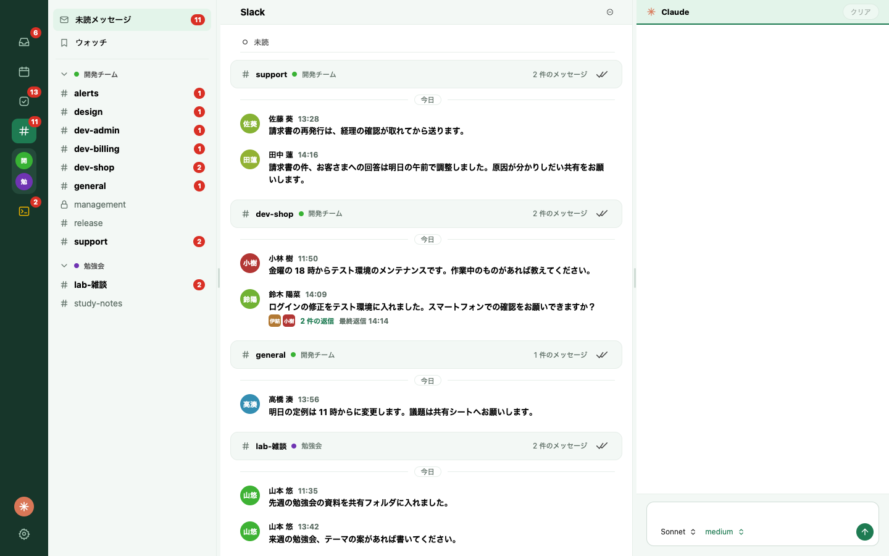

<p align="center">
  
</p>

<h1 align="center">cookapps</h1>

<p align="center">
  <strong>届いた連絡を、その場で Claude の仕事に。</strong><br />
  Gmail、カレンダー、Todo、Slack と Claude のセッションを、1 つのウィンドウに。
</p>

<p align="center">
  <a href="https://github.com/hidetsugu-miya/cookapps/releases/latest"></a>
  
  <a href="LICENSE"></a>
  
</p>

<h3 align="center">
  <a href="#インストール">インストール</a> ・ <a href="docs/features.md">機能</a> ・ <a href="#ドキュメント">ドキュメント</a>
</h3>

<p align="center">
  
</p>

## メールから、そのまま仕事を頼む

メール、Slack のスレッド、Todo を開いたまま、横のペインに指示を書くだけ。
内容ごと Claude に渡ります。
新しいセッションにも、動いているセッションにも渡せて、送る前に本文を確かめられます。

## 動いている Claude を、ここで見守る

対応が要るセッションは件数で、作業中はアイコンの点滅で分かります。
右のペインはセッションのターミナルで、そのまま打ち込めます。
渡したセッションの履歴と追加の指示は、メールや Todo の横の「Orca に渡す」ペインにあります。
[Orca](docs/orca.md) で動くセッションを、ウィンドウを切り替えずに扱えます。

<p align="center">
  
</p>

## 連絡と予定を、1 つの画面で

<table>
  <tr>
    <td width="50%" valign="top">
      <strong>受信トレイ</strong><br />
      複数の Gmail アカウントを 1 つの一覧に。アーカイブもゴミ箱もワンクリックで。<br /><br />
      
    </td>
    <td width="50%" valign="top">
      <strong>カレンダー</strong><br />
      全アカウントの予定を 1 つの週表示に。Meet にもすぐ入れます。<br /><br />
      
    </td>
  </tr>
  <tr>
    <td width="50%" valign="top">
      <strong>Todo</strong><br />
      Todoist のタスクを、期限が来たものから順に。メールからも作れます。<br /><br />
      
    </td>
    <td width="50%" valign="top">
      <strong>Slack</strong><br />
      未読と、自分で選んだスレッドだけを追えます。要約して Todo にもできます。<br /><br />
      
    </td>
  </tr>
</table>

## データは、あなたのマシンに

- cookapps にサーバーはありません。Gmail や Slack とは、あなたのマシンが直接話します。
- ログインの情報は OS のキーチェーンに保存します。
- Claude に内容を送るのは、あなたがボタンを押したときだけです。
- ソースコードはすべて公開しています。

詳しくは[プライバシーポリシー](docs/privacy/index.md)をご覧ください。

## インストール

macOS（Apple Silicon）のターミナルで実行します。

```sh
curl -fsSL https://github.com/hidetsugu-miya/cookapps/releases/latest/download/cookapps.app.tar.gz | tar xz -C /Applications
```

Apple の公証を受けていないので、ブラウザでダウンロードしたものは macOS に止められます。

最初に Google Cloud で OAuth クライアントを作り、`client_secret.json` を置きます（[手順](docs/setup.md#セットアップ)）。
以後の更新は、アプリの中のボタンから行えます。

## 対応しているもの

| | |
|---|---|
| OS | macOS（Apple Silicon） |
| メール | Gmail のみ。送信と返信はできません |
| Claude の機能 | [Claude Code](docs/claude-integration.md) と [Orca](docs/orca.md) が必要です。なくても、メール、カレンダー、Todo、Slack は使えます |
| 連携 | Google Calendar（閲覧のみ）、Todoist、Slack |

## ドキュメント

| | |
|---|---|
| [機能の一覧](docs/features.md) | できることのすべて |
| [セットアップと起動](docs/setup.md) | OAuth クライアントの作り方、ソースからの起動 |
| [Slack](docs/slack.md) | ワークスペースの追加、貼り付け、要約 |
| [Orca](docs/orca.md) | セッションの一覧、ターミナル、Claude への渡し方 |
| [Claude](docs/claude-integration.md) | 要約、接続方式、モデルの選び方 |
| [MCP サーバー](docs/mcp.md) | Claude Code から受信トレイと予定を扱う |

## ライセンス

[MIT](LICENSE)

役に立ったら、スターをもらえると励みになります。
