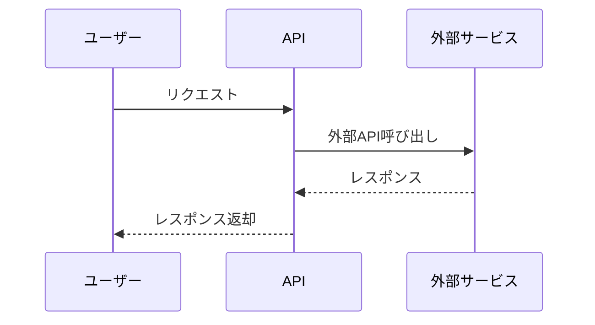

# Template of a specification

The structure of one specification file, for a backend feature.
Omit the sections that do not apply. Text in braces is what to write there.

````markdown
# {機能名}

## 概要

{この機能が何を実現するか、1〜3文で簡潔に記述}

### 背景

{なぜこの機能が必要か、ビジネス上の動機。不要なら削除}

### スコープ

- {対象とする範囲}
- {対象外とする範囲があれば明記}

---

## ユーザーフロー

{複数アクターが関わる場合のみ記載。不要なら削除}



---

## ビジネスロジック

### {ルール/ロジック名}

{ビジネスルールを箇条書きまたは条件表で記述}

| 条件 | 結果 |
|------|------|
| {条件1} | {結果1} |
| {条件2} | {結果2} |

{外部API・SDKに依存する場合は、利用サービス名・連携概要を記載}

{状態遷移がある場合は stateDiagram-v2 の Mermaid 図を使う}

---

## APIエンドポイント

{該当する場合のみ記載。不要なら削除}

### {操作名} - `{HTTPメソッド} {エンドポイント}`

{エンドポイントの概要を1行で}

#### エントリーポイント

`{controller や service のパス}`

---

## バックグラウンドジョブ

{該当する場合のみ記載。不要なら削除}

### {ジョブ名}

#### トリガー

{実行条件}

#### 処理概要

{ジョブの処理概要}
````
